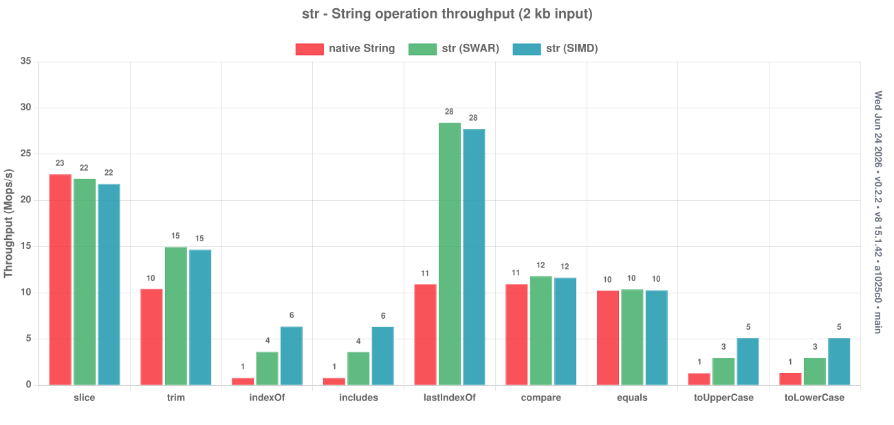

<h1 align="center"><pre>╔═╗╔═╗  ╔═╗╔╦╗╦═╗
╠═╣╚═╗══╚═╗ ║ ╠╦╝
╩ ╩╚═╝  ╚═╝ ╩ ╩╚═</pre></h1>

<p align="center">
  Virtual, drop-in, zero-copy strings for AssemblyScript: slice, search, and trim without copying character data. Analogous to Rust's <a href="https://doc.rust-lang.org/std/primitive.str.html">string slice</a>.
</p>

<details>
<summary>Table of Contents</summary>

- [Installation](#installation)
- [Flavors](#flavors)
- [Docs](#docs)
- [Usage](#usage)
- [Examples](#examples)
  - [Slicing and Trimming Without Copying](#slicing-and-trimming-without-copying)
  - [Tokenizing and Splitting](#tokenizing-and-splitting)
  - [Searching (String or View Needles)](#searching-string-or-view-needles)
  - [Comparisons and Operators](#comparisons-and-operators)
  - [Encoding (UTF-8 / UTF-16)](#encoding-utf-8--utf-16)
  - [The Two Layers](#the-two-layers)
  - [str8 - UTF-8 Views (byte-indexed)](#str8---utf-8-views-byte-indexed)
  - [Converting Anything: str(x) / str8(x)](#converting-anything-strx--str8x)
- [Performance](#performance)
  - [Per-Operation Speedup](#per-operation-speedup)
  - [Throughput](#throughput)
  - [SWAR and SIMD](#swar-and-simd)
  - [Running Benchmarks Locally](#running-benchmarks-locally)
- [Architecture](#architecture)
- [Contributing](#contributing)
- [License](#license)
- [Contact](#contact)

</details>

## Installation

```bash
npm install as-str
```

## Flavors

[as-str](https://github.com/AssemblyScript/as-str) has three modes. They all use
the same package; choose how much control you want over imports and optimization.

**Manual Mode (default)**

Import `str` where you use it and choose view boundaries yourself. This mode
does not use a transform and gives you explicit control over materialization.

```ts
import { str } from "as-str";

export function firstToken(line: string): string {
  const view: str = str(line);
  const space = view.indexOf(" ");
  const end = space < 0 ? view.length : space;
  return view.slice(0, end).toString();
}
```

**Global Mode**

Global mode injects `str` and `Str` imports, letting you use the library without
an import in every file. It does not optimize native strings.

Add the transform to your `asc` command:

```bash
--transform as-str/global
```

or in `asconfig.json`:

```json
{ "options": { "transform": ["as-str/global"] } }
```

Add the ambient typings to `assembly/tsconfig.json` so your editor resolves the
globals:

```json
{
  "extends": ["assemblyscript/std/assembly.json", "as-str/globals.json"],
  "include": ["./**/*.ts"]
}
```

You can then use `str` with no import:

```ts
export function firstToken(line: string): string {
  const view: str = str(line);
  const space = view.indexOf(" ");
  const end = space < 0 ? view.length : space;
  return view.slice(0, end).toString();
}
```

**Automatic Mode**

Automatic mode uses a shadow compiler pass for resolved type information, then
conservatively migrates safe internal `string` values to zero-copy `str` views.
It lowers values into views and lifts them back at native-string boundaries
while preserving exported and external signatures.

Add the transform to your `asc` command:

```bash
--transform as-str/auto
```

or in `asconfig.json`:

```json
{ "options": { "transform": ["as-str/auto"] } }
```

Your source continues to use native `string` types:

```ts
function hasCompactLabel(value: string): bool {
  const trimmed = value.trim();
  return trimmed.startsWith("api-") && trimmed.length <= 12;
}

export function formatLabel(value: string): bool {
  return hasCompactLabel(value);
}
```

After optimization, the relevant source shape is:

```ts
import { str } from "as-str";

function hasCompactLabel(value: string): bool {
  const trimmed: u64 = str.trimSpan(value);
  return (
    str.startsWithSpan(value, trimmed, "api-") &&
    str.spanLength(value, trimmed) <= 12
  );
}

export function formatLabel(value: string): bool {
  return hasCompactLabel(value);
}
```

The exported function keeps its native `string` signature while the internal
helper tracks the trimmed range as a packed span. The span stays linked to its
native owner for GC safety, and its scalar operations allocate neither a native
substring nor a `Str` wrapper.

The same packing covers chains such as `line.substring(i).trim()`, parser
cursors that move along one string (`rest = rest.substring(i + 1).trimStart()`),
fields of literal-separated splits (`url.split("?")[0]`,
`line.split(",").length`), and one-character comparisons (`s.charAt(i) == " "`
reads a code unit). A chain whose result must be a native string is copied once
at the end rather than at every link.

The optimizer leaves values native around raw loads, pointer casts, explicit
assertions, native-string call parameters, unknown calls, split arrays and other
containers, fields, nullable boundaries, and other operations it cannot prove
safe.
Native `toLowerCase()` calls retain native allocation behavior, including when
the result escapes to another function. Explicit views can use the lowercase
helper, which reuses already lowercase ASCII input.

Local overrides use comments because AssemblyScript does not allow decorators
on local variables:

```typescript
// @as-str no-view
const pointerSensitive = input.slice(1);

// @as-str prefer-view
const knownSafe = input;
```

Benchmark automatic mode against your workload when compile time, wall time,
memory use, or Wasm size matters.

**Single-Pass Automatic Mode**

Single-pass mode skips the shadow semantic compilation and only applies
syntax-proven local optimizations. Without cached semantic metadata it does not
promote function parameters or returns, making it faster to compile but potentially less aggressive than
`as-str/auto` on codebases where complete semantic analysis succeeds.

```bash
--transform as-str/single
```

```json
{ "options": { "transform": ["as-str/single"] } }
```

Source still uses native strings:

```ts
export function containsMarker(value: string): bool {
  const compact = value.trim().slice(0, 12);
  return (
    compact.includes("marker") ||
    compact.startsWith("mark") ||
    compact.length === 0
  );
}
```

**Cached Semantic Metadata**

For code that type-checks in global mode, single-pass mode can reuse a semantic
pass. Keep the entry files and compiler options the same in both commands:

```bash
mkdir -p build
AS_STR_MANIFEST_OUT=build/types.json npx asc assembly/index.ts --transform as-str/global -o build/module.wasm
AS_STR_MANIFEST_IN=build/types.json npx asc assembly/index.ts --transform as-str/single -o build/module.wasm
```

Caches record the compiler version, transform implementation, options, and source
identities, including dependencies. Changed inputs, malformed files, version 1
caches, and caches from optimized runs are rejected; single-pass mode then falls
back to syntax analysis.
Regenerate version 2 metadata with `as-str/global` after changes. Set
`STR_AS_DEBUG=1` to see whether a cache was accepted.

## Docs

Full documentation lives at:

<https://docs.jairus.dev/as-str>

## Usage

A `str` is a **view** into an existing `string`: a reference to the backing
string (so the GC keeps it alive) plus a `[start, end)` pair of raw byte
pointers. Slicing, trimming, and searching just move the two pointers - **no
characters are copied** until you materialize a real `string` with
`.toString()`.

```typescript
import { str } from "as-str";

const real: string = "GET /index.html 200 1043";

// Wrap once (zero-copy); creating each view allocates a small wrapper.
const req: str = str.from(real);

const method = req.slice(0, req.indexOf(" ")); // "GET" - a view
const path = str.slice(real, 4, 15); // "/index.html" - a view

method.toString(); // "GET"  - materialized on demand
path.length; // 11
req.includes("200"); // true
```

`str` is a class, so it is also the type - annotate with `str`. It is the
whole API: the instance methods **and** the static free functions
(`str.slice(s, …)`) live on it. It carries the **full native `String`
surface** (`slice`, `indexOf`, `trim`, `split`, `replace`, `toUpperCase`, …) plus
operators. Manual view creation allocates a small wrapper; `toString()` also
allocates and copies character data when materialization is needed.

## Examples

### Slicing and Trimming Without Copying

View-producing methods return another `str`, allocating a wrapper without copying
characters. The backing string is shared, and chains of views always anchor to
the original. Allocation-free views require transform lowering to scalar values
or packed spans. For example, `str.slice(s, 1, 3)` allocates one wrapper and
`str.from(s).slice(1, 3)` allocates two.

```typescript
const v = str.from("  the quick brown fox  ").trim(); // view, no copy
v.slice(4, 9).toString(); // "quick"
v.slice(-3).toString(); // "fox"
v.substring(10, 4).toString(); // "quick" (substring swaps args, like String)
v.charAt(0).toString(); // "t"
v.at(-1).toString(); // "x"
```

### Tokenizing and Splitting

`split` yields zero-copy pieces - you only pay for a copy on the pieces you
actually materialize.

```typescript
const log = "GET /index.html 200 1043";
const f = str.split(log, " "); // str[] - each piece is a view
f[0].toString(); // "GET"
<i32>parseInt(f[2].toString()); // 200
f.length; // 4

// Walk fields without copying character data:
const csv = "id,name,email,role";
for (let i = 0, parts = str.split(csv, ","); i < parts.length; i++) {
  if (parts[i].equalsString("email")) {
    /* found it - still zero-copy */
  }
}
```

### Searching (String or View Needles)

`indexOf`, `lastIndexOf`, `includes`, `startsWith`, and `endsWith` accept a
`string` **or** a `str` as the needle, so you can search a view inside a
view. The scan is SWAR/SIMD accelerated.

```typescript
const hay = str.from("the quick brown fox");
hay.indexOf("brown"); // 10
hay.includes(str.slice("xxbrownyy", 2, 7)); // true - view needle
hay.startsWith("the"); // true
hay.lastIndexOf("o"); // 17
```

### Comparisons and Operators

Operators compare and index content (not identity), across different backing
strings.

```typescript
const a = str.slice("__world", 2); // "world"
const b = str.slice("hello world", 6); // "world", different backing string

a == b; // true  (content equality)
a <= b; // true  (lexicographic)
str.from("apple") < str.from("banana"); // true
a[0]; // 119  - UTF-16 code unit at 0, no allocation (-1 if out of range)
(a + b).toString(); // "worldworld"  - `+` concatenates into a fresh view
```

### Encoding (UTF-8 / UTF-16)

`str.UTF8` and `str.UTF16` mirror `String.UTF8` / `String.UTF16`,
powered by [`utf-as`](https://github.com/JairusSW/utf-as) and running straight
off the view's pointer range - no intermediate copy. `decode` returns a
`str`.

```typescript
const v = str.slice("xx héllo 世界 xx", 3, 11); // "héllo 世界"

const u8 = str.UTF8.encode(v); // ArrayBuffer of UTF-8 bytes
str.UTF8.byteLength(v); // UTF-8 length, counted in place
str.UTF8.decode(u8); // str round-trip

const u16 = str.UTF16.encode(v); // the view's bytes, copied out
str.UTF16.validate(v); // well-formed UTF-16?
```

### The Two Layers

The same operations are reachable two ways:

```typescript
// 1. Instance methods on a view - the native String method surface.
const v = str.from("hello, world");
v.slice(7).toUpperCase(); // "WORLD"

// 2. Free functions - take a `string` OR a `str` as the first argument.
str.slice("hello, world", 7); // str
str.indexOf("hello, world", "world"); // 7
str.toUpperCase("hello"); // "HELLO" (allocates)
```

Convert a `string` to a view with **`str.from(s)`** (or `new str(data, start,
end)` from explicit bounds).

### Collection Compatibility

Use native `string` keys for `Map` and `Set` when equality should be based on
text. AssemblyScript hashes class references by identity even when their `==`
operator compares contents, so two distinct content-equal `str` or `str8`
objects are not reliable interchangeable keys. Materialize consistently with
`.toString()` for insertion and lookup. Views remain safe as map values.

The AssemblyScript 0.28 standard library also cannot directly compile
`Array<str | null>.join(...)` or `Array<str8 | null>.join(...)` because its
nullable check does not narrow classes with overloaded equality. Convert the
elements to native strings first, using an explicit non-null assertion after
the guard:

```ts
const value = values[i];
strings.push(value === null ? "" : value!.toString());
```

### str8 - UTF-8 Views (byte-indexed)

`str8` is the UTF-8 sibling of `str`, for text that already lives as UTF-8 bytes
(files, network, WASI, JSON) so you can slice/search/trim it without first
transcoding to UTF-16. It is stored as an `ArrayBuffer` plus `[start, end)` byte
pointers and is **byte-indexed**, following Rust `&str` / Go `string`.

```typescript
import { str8 } from "as-str";

const s = str8.from("héllo, 世界"); // string -> UTF-8 buffer (allocates)
s.length; // 14 (BYTES, like Rust .len() / Go len())
s.codePointCount(); // 9 (Unicode scalars)
s.slice(0, 3).toString(); // "hé" - O(1) zero-copy byte slice
s.indexOf("llo"); // byte offset (Go strings.Index / Rust .find)
s[0]; // 104 - the raw byte (Go s[i])
s.codePointAt(1); // 0xE9 ('é'), decoded from the 2-byte sequence
s.isCharBoundary(2); // false - byte 2 is mid-codepoint

// Wrap existing UTF-8 bytes with no copy:
const view = str8.fromBuffer(someArrayBuffer); // trusts the bytes
str8.fromBufferChecked(buf); // validates UTF-8 first
```

`equals`/`compareTo`/`<`…`>=` use byte order, which for UTF-8 is exactly Unicode
codepoint order (matching Rust/Go). Allocating ops (`concat`, `repeat`, `pad*`,
`replace`, `toUpperCase`, …) stay in UTF-8 and return a `str8`; `toString()`
decodes to a native `string`. Note slicing cuts raw bytes Go-style and can split
a codepoint - guard with `isCharBoundary` if you need a valid boundary.

### Converting Anything: `str(x)` / `str8(x)`

`str` and `str8` are also callable as converters. A view of the same type passes
through, a native `string` is wrapped/transcoded, and anything else with a
`toString()` (numbers, your own classes) is stringified. UTF-16 views passed to
`str8` are encoded directly, without materializing a temporary string:

```typescript
str(42).toString(); // "42"
str8("héllo").byteLength; // 6
str(someStr8); // str8 -> str (UTF-16)
v.toStr8(); // str  -> str8 (UTF-8)
u.toStr(); // str8 -> str  (UTF-16)
```

## Performance

📊 **[Browse the full chart set for this release →](https://github.com/JairusSW/as-str/tree/docs/charts/v0.2.2)**

### Per-Operation Speedup

Every native `String` operation vs its `str` counterpart - native (red) is
the `1×` baseline, `str` (blue) is its speedup:


### Throughput

Native vs `str` SWAR vs `str` SIMD, in millions of ops/sec:



### SWAR and SIMD

The scanning hot paths are accelerated in three tiers, chosen at **compile
time**:

- **SIMD** - 8 code units per step via `v128`, used when `--enable simd` is set
  (`ASC_FEATURE_SIMD`).
- **SWAR** - *SIMD-Within-A-Register*: 4 code units per step with ordinary `u64`
  math. The default when SIMD is off.
- **scalar** - handles the short sub-block tail.

When SIMD is off the entire `v128` branch is dead-code-eliminated, and vice
versa, so you only pay for the tier you build. Wide loads are always bounded by
the remaining length, so they never read past the backing string - no scratch
padding. Both builds are covered by the test suite (run under two modes) and by
differential fuzzing against the native `String` methods.

### Running Benchmarks Locally

```bash
npm run bench         # microbenchmarks (as-bench)
npm run bench:runtime # equality, repeat, padding, search and codepoint slices
npm run bench:payloads # parsing, search, normalization and encoding workflows
npm run charts:build  # benchmark both builds and render charts to build/charts/
npm run charts        # build the charts and serve them locally
```

To compare runtime changes against a saved local baseline:

```bash
npm run bench:runtime -- --out build/runtime-baseline
# Make the change, then compare both SIMD and non-SIMD builds:
npm run bench:runtime -- --baseline build/runtime-baseline
```

The comparison checks result checksums and records alternating-run median
timings, individual samples, build hashes, and runtime metadata in
`build/runtime-performance/results.json`. Use `--filter first16` (or another
workload substring) to narrow a run, and `--samples 11` to change the sample count.

The payload suite combines deterministic representative HTTP, URL, log, TSV,
Unicode text and JSON records with actual source files from this repository.
It includes request-field extraction, message byte sizing, and conversion of
trimmed UTF-16/UTF-8 views.
Each record is checked against an independent JavaScript reference in both
UTF-16 and UTF-8 modes. Inputs are prepared before timing; operations such as
encoding a native string needle, splitting fields, and normalizing text stay
inside the measured work. Separate instrumented builds count runtime allocation
blocks without adding tracing overhead to the timing builds.

```bash
npm run bench:payloads -- --out build/payload-baseline
# Reuse exactly the same records after changing the implementation:
npm run bench:payloads -- --baseline build/payload-baseline \
  --corpus build/payload-baseline/corpus.json
```

Results, individual timing samples, allocation counts, corpus data, and build
hashes are saved under `build/payload-performance/`. These local Node/V8 results
are workload-specific; allocation counts are not peak memory or RSS measurements.

## Architecture

A `str` is a 3-field view - `data: string` (the GC owner), and `start` /
`end` raw byte pointers into that string's UTF-16 data. Every op moves the
pointers; bytes are copied only by `toString()` (and the allocating ops, which
build their result in one pass).

- **Single source of truth.** Instance methods and the `str.*` free
  functions both funnel through `*Range` static helpers that operate on raw
  `(data, start, end)` bounds - so a view-producing op is exactly one allocation
  (the result) and a query is zero.
- **Accelerated primitives.** `findUnit` (powers `indexOf`/`includes`/
  `lastIndexOf`) and `compare` carry SIMD / SWAR / scalar tiers; `copyBytes` and
  `equalsBytes` use a size-tiered manual loop that beats the bulk-memory
  intrinsics on small/medium ranges.
- **Native parity.** Semantics mirror AssemblyScript's `String` (not JS) and are
  verified bit-for-bit by differential fuzzing across both SIMD and SWAR builds.
- **GC-safe.** A view keeps its backing string reachable through `data`, and
  views of views anchor to the original - so chains of slices never pin
  intermediate allocations and the underlying bytes are never collected while a
  view is alive.

## Contributing

Contributions are welcome. To work on `str`:

```bash
npm install
npm test          # spec suite (as-test), under simd + nosimd modes
npm run test:fuzz # differential fuzzing vs native String
npm run check     # lint + typecheck
```

## License

This project is distributed under an open source license. Work on this project
is done by passion, but if you want to support it financially, you can do so by
making a donation to the project's [GitHub Sponsors](https://github.com/sponsors/JairusSW)
page.

You can view the full license here: [License](./LICENSE)

## Contact

Please send all issues to [GitHub Issues](https://github.com/JairusSW/as-str/issues),
and to converse, send me an email at [me@jairus.dev](mailto:me@jairus.dev).

- **Email:** Send me inquiries, questions, or requests at [me@jairus.dev](mailto:me@jairus.dev)
- **GitHub:** Visit the official GitHub repository [Here](https://github.com/JairusSW/as-str)
- **Website:** Visit my official website at [jairus.dev](https://jairus.dev/)
- **Discord:** Contact me at [My Discord](https://discord.com/users/600700584038760448) or on the [AssemblyScript Discord Server](https://discord.gg/assemblyscript/)
